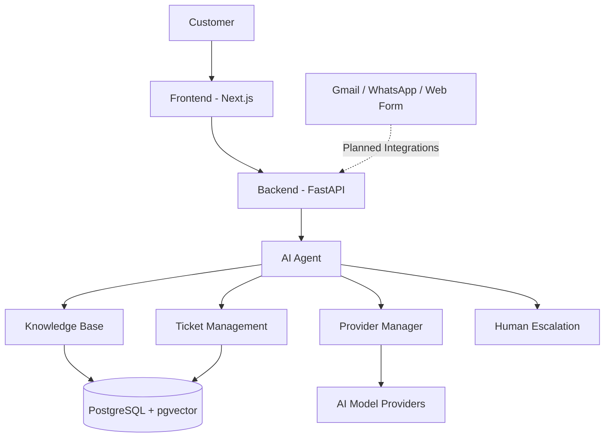

# 🤖 24/7 Digital Employee
### AI-Powered Customer Success Automation Platform

An intelligent, AI-powered customer support platform designed to automate customer interactions across multiple communication channels. The 24/7 Digital Employee acts as a virtual customer success representative, helping businesses handle customer queries, retrieve relevant information, manage support tickets, and streamline customer service operations.

**Built with Python, Next.js, TypeScript, OpenAI Agents SDK, and PostgreSQL.**

[](https://24-7-digital-employee.vercel.app)
[](https://github.com/hooriyaa/24-7_Digital_Employee)

---

## 📌 Overview

Traditional customer support teams often spend significant time answering repetitive questions, managing support tickets, and handling customer conversations across different platforms.

**24/7 Digital Employee** aims to solve this problem through an AI-driven customer success architecture.

The platform combines AI agents, knowledge retrieval, database management, and multi-channel communication capabilities to create an intelligent digital employee that can assist customers around the clock.

The project focuses on building a reusable and extensible foundation for automated customer support.

## ✨ Key Features

### 1. AI-Powered Customer Support Agent
- Intelligent customer query handling.
- Context-aware response generation.
- Agent instructions with context prioritization.
- AI-powered customer interaction workflows.
- Multi-provider AI support with fallback configuration.

### 2. Knowledge Base & Retrieval
- Knowledge base search and retrieval.
- Flexible keyword matching.
- Full-context retrieval for improved answer quality.
- PostgreSQL with pgvector support.
- Context-aware information processing.

### 3. Customer Relationship Management
- Customer record management.
- Conversation management.
- Message tracking.
- Support ticket data models.
- Centralized customer information.

### 4. Multi-Channel Support Architecture
Designed to support customer interactions through:

- Gmail / Email
- WhatsApp
- Website Support Form

Channel integrations are part of the development roadmap and are not all production-ready yet.

### 5. Human Escalation
- Human support escalation capability.
- Support workflow handoff.
- Ticket-oriented customer support architecture.

## 🏗️ System Architecture

The platform follows a modular architecture that separates the frontend, backend, AI agent, knowledge retrieval, and database layers.



## 🛠️ Technology Stack

| Category | Technologies |
|---|---|
| Frontend | Next.js, React, TypeScript |
| Backend | Python, FastAPI |
| AI Agent | OpenAI Agents SDK |
| AI Providers | Gemini, Multi-provider fallback |
| Database | PostgreSQL |
| Vector Search | pgvector |
| Knowledge Retrieval | Context-based retrieval |
| Deployment | Vercel (Frontend) |
| Development | Git, GitHub |

## 📂 Project Structure

```text
24-7_Digital_Employee/
│
├── backend/
│   └── AI agent and backend services
│
├── frontend/
│   └── Next.js application
│
├── context/
│   └── Project context and knowledge resources
│
├── spec/
│   └── Project specifications
│
├── specs/
│   └── Technical specifications
│
├── .qwen/
│   └── Development configuration
│
├── CONTEXT_IMPLEMENTATION.md
├── IMPLEMENTATION_STATUS.md
├── SLC.md
├── WHATSAPP_INTEGRATION_COMPLETE.md
├── requirements.md
├── slc_universal_structure.md
├── dev.bat
└── start_all.bat
```

## 🧠 AI Agent Workflow

The AI agent is designed to process customer interactions through a structured workflow:

1. **Receive Query:** Receive a customer query through a supported interface.
2. **Understand Context:** Analyze the customer request and available conversation context.
3. **Retrieve Knowledge:** Search the knowledge base for relevant information.
4. **Generate Response:** Use the configured AI provider to generate a context-aware response.
5. **Manage Support:** Support ticket creation and customer interaction workflows.
6. **Escalate When Needed:** Transfer complex cases to human support.

## 🗄️ Database Architecture

The project uses PostgreSQL as its primary relational database, with pgvector support for vector-based knowledge retrieval.

Core data models include:

- Customers
- Conversations
- Messages
- Tickets
- Knowledge Base

The architecture is designed to maintain customer information and support interactions in a centralized system.

## 🚀 Getting Started

### Prerequisites

Before setting up the project, ensure you have:

- Python 3.10+
- Node.js and npm
- PostgreSQL
- Git
- Required AI provider API credentials

### 1. Clone the Repository

```bash
git clone https://github.com/hooriyaa/24-7_Digital_Employee.git

cd 24-7_Digital_Employee
```

### 2. Backend Setup

Navigate to the backend directory:

```bash
cd backend
```

Create and activate a virtual environment:

```bash
python -m venv venv
```

Windows:

```bash
venv\Scripts\activate
```

Install the dependencies using the project's dependency configuration.

### 3. Frontend Setup

Navigate to the frontend directory:

```bash
cd frontend
```

Install dependencies:

```bash
npm install
```

Start the development server using the script configured in `package.json`.

### 4. Environment Configuration

Configure the required environment variables for:

- Database connection
- AI provider API credentials
- Backend and frontend communication
- External service integrations

**Security:** Never commit API keys, database passwords, access tokens, or private credentials to GitHub.

Refer to the project configuration and dependency files for the exact setup requirements.

## 🔐 Security & Reliability

Security is an important consideration for an AI-powered customer support system.

Development priorities include:

- Secure API credential management.
- Database access protection.
- Input validation and error handling.
- Safe handling of customer information.
- AI response quality and context validation.
- Dependency and vulnerability monitoring.

## 🗺️ Development Roadmap

The project is under active development.

| Feature | Status |
|---|---|
| Core AI Agent | Implemented |
| Knowledge Base Search | Implemented |
| Multi-provider Support | Implemented |
| PostgreSQL Data Models | Implemented |
| CRUD Operations | Implemented |
| Human Escalation | Implemented |
| Web Support Form | In Progress |
| Gmail Integration | Planned |
| UltraMsg WhatsApp Integration | Planned |
| Kafka Event Streaming | Planned |
| Complete Ticket Workflow | In Progress |
| Automated Testing Suite | Planned |
| Kubernetes Deployment | Planned |
| Context7 Primary Retrieval | Planned |

*Status reflects the implementation report dated March 5, 2026, and should be updated as development progresses.*

## 🤝 Contributing

Contributions, suggestions, and feedback are welcome.

If you are interested in improving the project:

1. Fork the repository.
2. Create a feature branch.
3. Implement your changes.
4. Test your implementation.
5. Submit a pull request with a clear description.

Please open an issue before making major architectural changes.

## 🎯 Project Vision

The long-term vision is to create an extensible AI-powered digital employee platform that helps businesses reduce repetitive customer support work, improve response efficiency, and deliver consistent customer experiences.

The goal is to make intelligent customer support automation more accessible through modular architecture, AI agents, and reusable integrations.

## 👩‍💻 Maintainer

**Hooriya M. Fareed**

AI & Full Stack Developer

GitHub: [@hooriyaa](https://github.com/hooriyaa)

Project: [24/7 Digital Employee](https://github.com/hooriyaa/24-7_Digital_Employee)

---

<p align="center">
  <b>Building intelligent customer experiences with AI.</b>
  <br/>
  Made with ❤️ for the future of AI-powered customer support.
</p>
